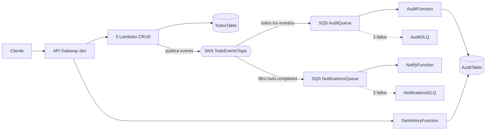
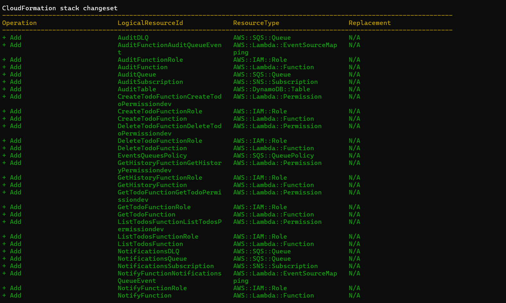
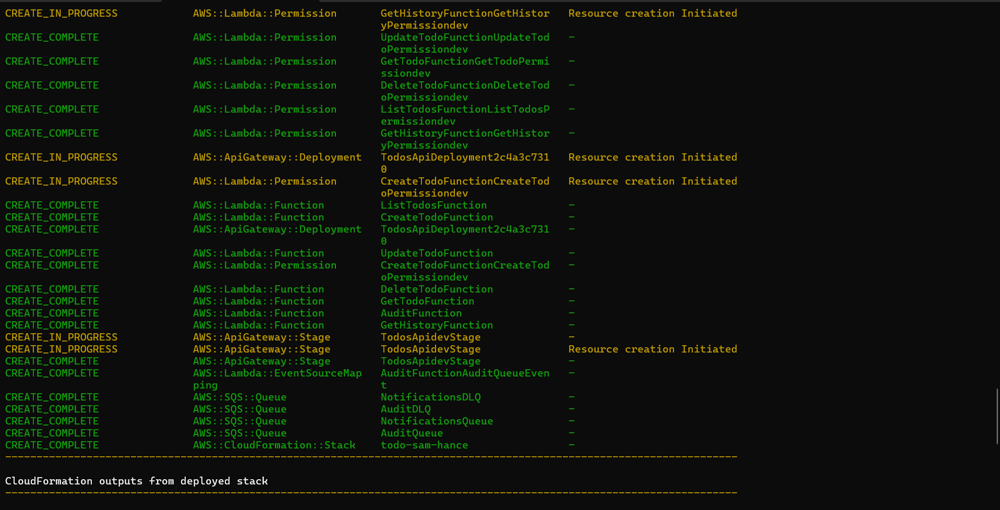
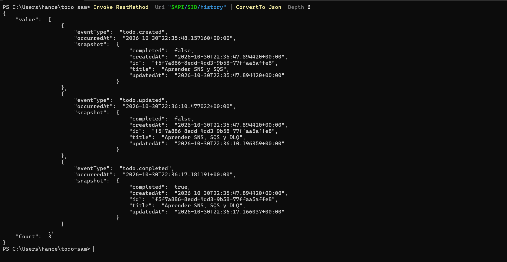
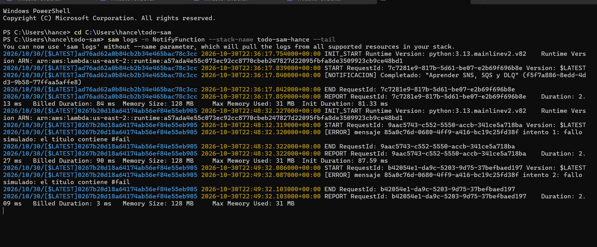
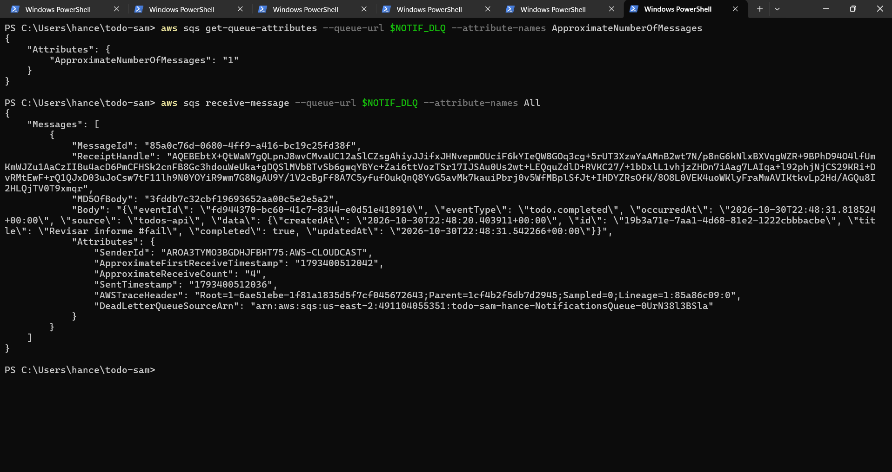
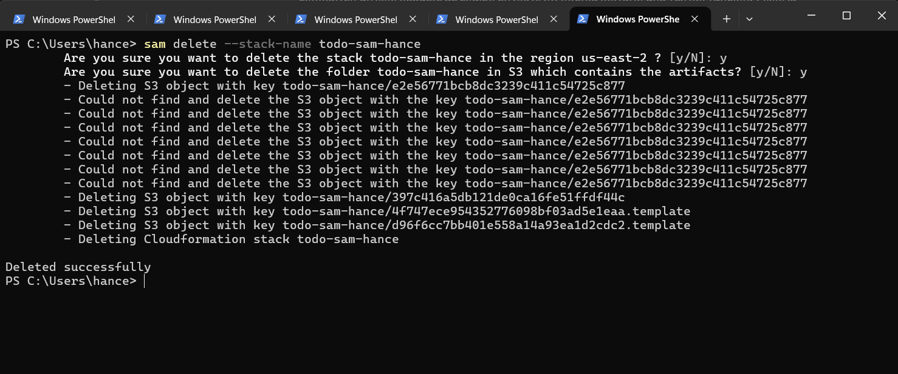

# Workshop: CRUD de TODOs con AWS SAM (Python)

**Autor:** Hance trujillo. · **Curso:** Programación Agéntica

API REST serverless para gestionar una lista de tareas, definida 100% como código con AWS SAM y desplegada en mi propia cuenta de AWS.

## Arquitectura

```
Cliente (curl / Postman / PowerShell)
        │
   API Gateway (REST, stage dev)
        │
 ┌──────┼───────┬───────────┬────────────┐
Create  List   Get       Update       Delete     ← 5 funciones Lambda (python3.13)
        └──────┴───────┴────────────┘
                     │
                DynamoDB (TodosTable, PAY_PER_REQUEST)
```

| Método | Ruta | Respuesta OK | Errores |
|---|---|---|---|
| POST | `/todos` | 201 + TODO creado | 400 |
| GET | `/todos` | 200 + lista | — |
| GET | `/todos/{id}` | 200 + TODO | 404 |
| PUT | `/todos/{id}` | 200 + TODO actualizado | 400, 404 |
| DELETE | `/todos/{id}` | 204 sin contenido | 404 |

## Estructura del proyecto

```
todo-sam/
├── template.yaml        # infraestructura
├── samconfig.toml       # configuración de deploy
├── src/
│   ├── utils.py         # cliente DynamoDB, response(), parse_body()
│   ├── create_todo.py
│   ├── list_todos.py
│   ├── get_todo.py
│   ├── update_todo.py
│   └── delete_todo.py
└── capturas/            # evidencias de la entrega
```

## Cómo desplegar

```powershell
sam validate --lint
sam build
sam deploy --guided
```

Datos de mi despliegue: stack `todo-sam-hance`, región `us-east-2` (Ohio).

## Cómo probar

```powershell
$API = "https://<id>.execute-api.us-east-2.amazonaws.com/dev/todos"

Invoke-RestMethod -Method Post -Uri $API -ContentType "application/json" -Body '{"title": "Estudiar AWS SAM"}'
Invoke-RestMethod -Uri $API
```

## Limpieza

```powershell
sam delete --stack-name todo-sam-hance
```

Verifiqué en CloudFormation que el stack quedó en `DELETE_COMPLETE`.

---

## Qué aprendí

- **Infraestructura como código:** un solo `template.yaml` de unas 120 líneas describe la tabla, la API, las cinco funciones y sus permisos. SAM lo expande a CloudFormation y crea por mí los roles IAM, los permisos de invocación, el deployment y el stage.
- **El ciclo completo:** `sam build` → `sam deploy` → pruebas → logs en CloudWatch → `sam delete`. Tener todo en código hace que crear y destruir el entorno sea reproducible.
- **Mínimo privilegio:** las funciones de lectura usan `DynamoDBReadPolicy` y las de escritura `DynamoDBCrudPolicy`, ambas limitadas a una sola tabla.
- **Arranque en frío:** en los logs de CloudWatch, la primera invocación de `CreateTodoFunction` tardó unos 490 ms (con 463 ms de inicialización) y las siguientes bajaron a 27 y 58 ms.
- **Detalles de DynamoDB:** `title` es palabra reservada y requiere un alias (`#t`); `ConditionExpression` evita que un PUT cree registros por accidente; DynamoDB devuelve números como `Decimal` y hay que convertirlos antes de serializar a JSON.

### Dificultades que resolví

- En **PowerShell 5.1** no existe `&&`, así que ejecuté los comandos uno por línea (o con `;`). Para las pruebas usé `Invoke-RestMethod` y `Invoke-WebRequest` en lugar de `curl`.
- Los archivos de `src/` se crearon vacíos (0 bytes) y los llené antes de hacer el build; si no, las funciones habrían fallado con error 500.
- En `sam deploy --guided`, las preguntas de autenticación de cada función exigen escribir `y`: con Enter el valor por defecto es `N` y el deploy se cancela con `Security Constraints Not Satisfied!`. Las preguntas del archivo y entorno de configuración se aceptan con Enter.
- Mi región configurada era `us-east-2`, no `us-east-1`; tuve que mirar la región correcta en la consola para ver los recursos.

---

## Preguntas de repaso

**1. ¿Por qué las Lambdas no tienen el nombre de la tabla escrito en el código?**
CloudFormation genera el nombre real de la tabla con un sufijo aleatorio (por ejemplo `todo-sam-hance-TodosTable-139TX9R7HN6KX`). El template lo inyecta como variable de entorno `TABLE_NAME` con `!Ref TodosTable`. Así el mismo código funciona en cualquier stack, región o cuenta sin modificarse, y no hay valores duros que se desactualicen.

**2. ¿Qué pasaría en el PUT si quitamos el `ConditionExpression`?**
`update_item` funciona como *upsert*: si el id no existe, DynamoDB crea un ítem nuevo con solo la clave y los campos enviados. El PUT devolvería 200 en vez de 404 y dejaría registros incompletos (sin `createdAt`, y sin `title` si solo se mandó `completed`).

**3. ¿Qué diferencia hay entre `DynamoDBReadPolicy` y `DynamoDBCrudPolicy`, y por qué no darle Crud a todas?**
`DynamoDBReadPolicy` permite solo operaciones de lectura (`GetItem`, `Scan`, `Query`, etc.). `DynamoDBCrudPolicy` agrega escritura y borrado (`PutItem`, `UpdateItem`, `DeleteItem`). Dar Crud a todas rompe el principio de mínimo privilegio: si una función de solo lectura tiene un bug o es comprometida, podría modificar o borrar datos. Lo comprobé comparando los roles `ListTodosFunctionRole` y `CreateTodoFunctionRole` en IAM.

**4. ¿Qué recursos de AWS creó SAM que no escribí explícitamente?**
Cinco roles IAM (uno por función), cinco `AWS::Lambda::Permission` para que API Gateway pueda invocar cada Lambda, la `AWS::ApiGateway::RestApi` subyacente, el `AWS::ApiGateway::Deployment` y el `AWS::ApiGateway::Stage` `dev`. Con CloudFormation puro serían cientos de líneas más.

**5. ¿Cuándo preferiría una Lambda por operación y cuándo una sola?**
*Una por operación* cuando importan los permisos mínimos por función, el escalado y despliegue independientes, paquetes pequeños y logs claros por operación. *Una sola Lambda* cuando se prioriza la simplicidad, menos arranques en frío (una sola función se mantiene caliente) y se comparte mucha lógica; el costo es que todas las rutas terminan con los permisos más amplios y un código más grande.

---

## Reto adicional

_(Opcional: describir aquí el reto que se resuelva, por ejemplo filtro por estado, paginación o `DynamoDBWritePolicy`. Si no se hizo ninguno, eliminar esta sección.)_

## Checklist de entrega

- [x] `template.yaml`, `src/` y `samconfig.toml`
- [ ] Captura de los Outputs de `sam deploy`
- [ ] Capturas de las 5 operaciones CRUD
- [ ] Capturas de los errores 400 y 404
- [ ] Captura de los logs de CloudWatch
- [ ] Captura de `sam delete` completado

---

# Parte 2: Microservicios con SNS y SQS

**Autor:** _(tu nombre completo)_ · **Rama:** `parte-2` · **Stack:** `todo-sam-hance` (`us-east-2`)

La API de la Parte 1 sigue respondiendo igual, pero ahora cada escritura exitosa (crear, actualizar, completar, borrar) publica un **evento de dominio** en un topic de Amazon SNS. Cada microservicio interesado se suscribe con su propia cola de Amazon SQS y procesa los eventos a su ritmo, sin que la API sepa que existe.

## Arquitectura



| Evento | Lo publica | Lo reciben |
|---|---|---|
| `todo.created` | `CreateTodoFunction` | Audit |
| `todo.updated` | `UpdateTodoFunction` | Audit |
| `todo.completed` | `UpdateTodoFunction` | Audit y Notify |
| `todo.deleted` | `DeleteTodoFunction` | Audit |

Ruta nueva: `GET /todos/{id}/history` devuelve el historial de eventos de un TODO, y sobrevive al borrado del TODO.

## Qué cambió respecto a la Parte 1

- `template.yaml`: topic SNS, 2 colas SQS con sus DLQ, política de cola, suscripciones (una con `FilterPolicy`), `AuditTable` y 3 funciones nuevas.
- `utils.py`: función `publish_event`. `create_todo.py`, `update_todo.py` y `delete_todo.py`: publican después de escribir con éxito.
- Nuevos: `audit_consumer.py`, `notify_consumer.py`, `get_history.py`.
- Sin cambios: `list_todos.py`, `get_todo.py` y el contrato de las 5 rutas originales.

## Evidencias

### Change set y Outputs del deploy




### Historial de un TODO (3 eventos, incluido `todo.completed`)



### Logs de Audit y Notify: el filtro en acción

Con las mismas tres operaciones (crear, editar, completar), `AuditFunction` registró **3 eventos** y `NotifyFunction` solo **1**, porque la `FilterPolicy` de SNS descartó `todo.created` y `todo.updated` antes de que llegaran a su cola.


### Mensaje venenoso (`#fail`): reintentos y DLQ

Un TODO con `#fail` en el título hace fallar a `NotifyFunction` siempre. La API respondió `200` (el fallo ocurre en otro microservicio) y `AuditFunction` procesó el mismo evento sin problema. SQS reintentó 3 veces y luego movió el mensaje a la DLQ.




### Redrive

Comenté las dos líneas del `#fail` en `notify_consumer.py`, desplegué con `sam build; sam deploy` y devolví el mensaje a su cola original con `aws sqs start-message-move-task`. `NotifyFunction` lo procesó con éxito.


### Limpieza



## Qué aprendí

- **Desacoplamiento real:** agregar un consumidor nuevo no exige tocar el código del CRUD, solo el template y una función nueva.
- **Fan-out y filtros:** un solo `sns.publish` alimenta varias colas, y la `FilterPolicy` evalúa el atributo `eventType` sin abrir el cuerpo del mensaje.
- **Aislamiento de fallos:** el mensaje `#fail` rompió a `NotifyFunction` pero no a `AuditFunction`, porque cada consumidor tiene su cola, su ritmo, sus reintentos y su DLQ.
- **Fallos parciales:** devolver `batchItemFailures` reintenta solo los mensajes que fallaron; lanzar una excepción reencolaría el lote completo.
- **Arranque en frío:** en los logs, la primera invocación de `AuditFunction` tardó unos 285 ms (con 509 ms de inicialización); las siguientes, 40 ms y 17 ms.
- **Un detalle del deploy:** al corregir solo `notify_consumer.py`, el change set marcó `Modify` en las **8** funciones, no solo en `NotifyFunction`. Las ocho comparten `CodeUri: src/`, así que cualquier cambio en esa carpeta cambia el paquete de todas.
- **`ApproximateReceiveCount: 4`** en la DLQ: 3 intentos de la Lambda más la lectura manual que hice con `receive-message`.
- **Credenciales temporales:** la sesión de `aws login` caducó a mitad de la práctica y bastó repetir `aws login` para continuar sin perder nada de lo desplegado.

## Preguntas de repaso

**1. ¿Qué diferencia hay entre SNS y SQS? ¿Por qué se usan juntos?**
SNS es publicación/suscripción: un productor publica una vez y SNS empuja una copia a todos los suscriptores. SQS es una cola: guarda los mensajes hasta que un consumidor los lee, con buffer, reintentos y DLQ. Juntos dan *fan-out con buffer*: un evento llega a varios consumidores, y cada uno lo procesa a su ritmo y con sus propios reintentos.

**2. Si mañana se agrega un microservicio de estadísticas, ¿qué archivos del CRUD hay que modificar?**
Ninguno. Los productores publican en el topic sin saber quién escucha. Solo cambia `template.yaml` (una cola nueva con su DLQ, su suscripción, el permiso de la cola en `EventsQueuesPolicy` y la función consumidora) y se añade el código del nuevo consumidor.

**3. Un lote trae 10 mensajes y falla 1. ¿Qué pasa si el handler devuelve `batchItemFailures`? ¿Y si lanza una excepción?**
Con `batchItemFailures`, los 9 mensajes buenos se borran de la cola y solo el que falló vuelve a ser visible para reintentarse. Si el handler lanza una excepción, falla el lote completo y los 10 mensajes se reintentan, incluidos los 9 ya procesados, que se duplican. Por eso conviene capturar los errores mensaje por mensaje y diseñar consumidores idempotentes.

**4. ¿Por qué la `sk` de `AuditTable` incluye el `eventId`? ¿Qué problema evita?**
La `sk` es `occurredAt#eventId`. El `occurredAt` da el orden cronológico, y el `eventId` evita que dos eventos del mismo TODO con el mismo instante se sobrescriban entre sí. Además es determinista: si SQS entrega el mismo mensaje dos veces, se escribe la misma clave y el segundo `put_item` sobrescribe el ítem en lugar de duplicarlo. Eso hace al consumidor idempotente.

**5. ¿Por qué el `VisibilityTimeout` de la cola debe ser mayor que el `Timeout` de la Lambda?**
Mientras una Lambda procesa un mensaje, este queda invisible durante el `VisibilityTimeout`. Si ese tiempo fuera menor que lo que tarda la función, el mensaje volvería a ser visible mientras aún se procesa y otra invocación lo tomaría, duplicando el trabajo. AWS recomienda al menos 6 veces el `Timeout` de la función (aquí 60 s frente a 10 s).

**6. El mensaje `#fail` lo procesó bien `AuditFunction` pero no `NotifyFunction`. ¿Qué propiedad de la arquitectura demuestra eso?**
El **aislamiento de fallos** (desacoplamiento entre consumidores). Cada consumidor tiene su propia cola, sus reintentos y su DLQ, así que el fallo de uno no afecta a los demás ni a la API que publicó el evento.

**7. ¿Qué riesgo tiene publicar en SNS después de escribir en DynamoDB, y cómo lo mitigarías?**
Es una *doble escritura* sin transacción común. Si el `PutItem` tiene éxito y la publicación en SNS falla, el TODO existe pero el evento nunca sale, y el cliente recibe un error 502. Se mitiga con el patrón **outbox**: activar DynamoDB Streams en `TodosTable` y publicar los eventos desde una Lambda del stream (o con EventBridge Pipes), de modo que el evento se derive siempre del dato ya guardado.

## Checklist de la Parte 2

- [x] Código completo: `template.yaml`, `src/` y `samconfig.toml`
- [x] Change set y Outputs
- [x] `GET /todos/{id}/history` con 3 eventos
- [x] Logs de `AuditFunction` y `NotifyFunction` (filtro)
- [x] Mensaje `#fail`: 3 intentos y DLQ con 1 mensaje
- [x] Redrive exitoso
- [x] `sam delete` completado
- [x] README con diagrama y respuestas de repaso

